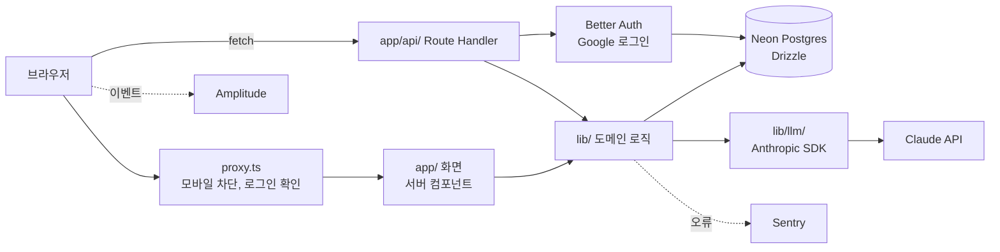
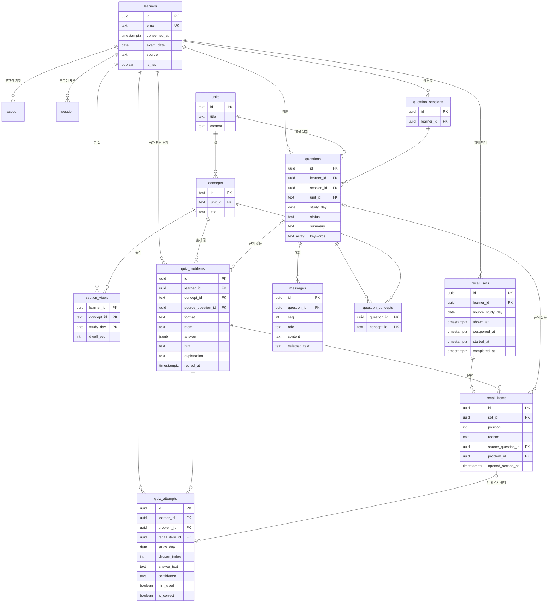
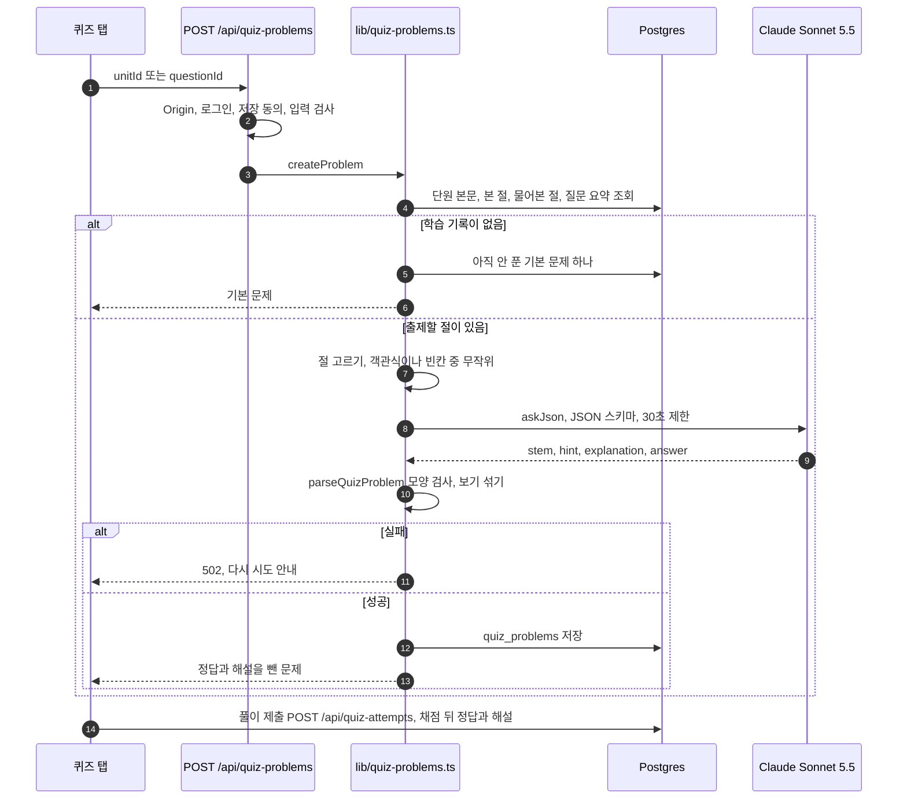
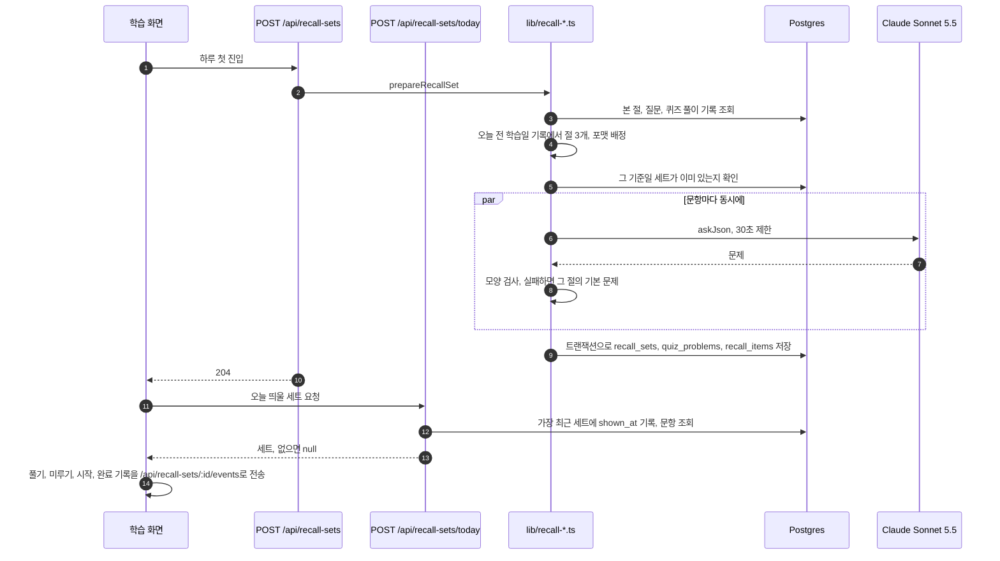

# Pluck

SQLD를 공부하는 학습자가 단원을 읽다가 AI에게 묻고, 다음 날 꺼내 먹기 퀴즈로 정말 이해했는지 확인하는 AI 리딩 파트너예요. 학습자가 묻고 확인한 내용을 데이터로 남겨 학습자 개인과 학습 플랫폼이 활용하게 하는 것이 목적이에요.

## 주요 기능

- **질문 답변**: 단원을 읽다가 문장을 드래그하거나 직접 물으면 AI가 단원 본문을 근거로 답해요. 답은 스트리밍으로 보여 주고, 같은 개념을 전에 물었다면 그 날짜를 알려 줘요.
- **질문 분류와 요약**: 질문마다 단원의 개념 하나를 고르고, 답이 끝나면 대화를 요약해 다음 답변과 퀴즈 생성에 써요.
- **학습 퀴즈**: 퀴즈 탭에서 지금 단원 중 내가 읽거나 물어본 절로 AI가 객관식이나 빈칸 문제를 하나씩 만들어요. 학습 기록이 없으면 미리 만든 기본 문제를 내요.
- **꺼내 먹기**: 다음 날 처음 들어오면 지난 학습일 기록에서 개념 3개를 골라 문제를 만들고, 풀고 나면 그 절로 바로 돌아가 다시 읽게 해요.
- **학습 기록**: 본 절, 질문과 답, 문제와 풀이, 확신도, 힌트 사용 여부를 모두 DB에 남겨요.

## 기술 스택

| 영역 | 선택 |
| --- | --- |
| 프레임워크 | Next.js 16 App Router, React 19, TypeScript |
| 스타일 | Tailwind CSS 4, Pretendard |
| DB | Neon Postgres, Drizzle ORM |
| 인증 | Better Auth, Google 로그인 |
| AI | Anthropic SDK, Claude Sonnet 5.5와 Claude Haiku 5.5 |
| 모니터링과 분석 | Sentry, Amplitude |
| 테스트 | Vitest, Playwright |
| 배포 | Vercel |

스택을 고른 이유는 [기술 스택 문서](_docs/wiki/tech-stack.md)와 [ADR 목록](_docs/wiki/adr/)에 있어요.

## 아키텍처



- **화면과 API를 나눈 기준**: 첫 화면을 그리는 데이터는 서버 컴포넌트가 `lib/`를 바로 불러 읽어요. 질문, 퀴즈 생성, 풀이 저장처럼 사용자 동작으로 일어나는 일은 `app/api/`의 Route Handler를 거쳐요.
- **Route Handler는 얇게 둬요**: Origin 확인, 로그인, 저장 동의, 입력 검사만 하고 실제 일은 `lib/`의 함수에 맡겨요. 그래서 `lib/` 함수를 통합 테스트로 바로 확인할 수 있어요.
- **AI 호출은 `lib/llm/`에만 있어요**: 구조화된 응답이 필요한 호출은 모두 `askJson`으로 JSON 스키마를 지정하고 제한 시간을 둬요. AI가 돌려준 값은 저장하기 전에 서버가 모양을 다시 검사해요.
- **모델 ID는 환경 변수로만 읽어요**: 질문 답변과 퀴즈 생성은 `ANTHROPIC_MODEL`, 질문 분류와 요약, 서술형 채점은 `ANTHROPIC_UTILITY_MODEL`을 써요.
- **답을 먼저 보내고 뒷일은 나중에 해요**: 질문 답변은 SSE로 스트리밍하고, 대화 요약은 `after()`로 응답을 보낸 뒤에 돌려요.

## DB 구조



| 테이블 | 담는 것 | 알아 둘 규칙 |
| --- | --- | --- |
| `learners`, `account`, `session`, `verification` | 학습자와 Better Auth 로그인 정보 | 학습자를 지워도 질문 내역은 지우지 않아요 |
| `units`, `concepts` | 단원 본문과 단원 안의 절 | ID는 한 번 넣으면 바꾸지 않아요 |
| `question_sessions`, `questions`, `messages` | 질문 창의 대화, 질문 하나, 주고받은 메시지 | 질문 ID는 클라이언트가 만들어 같은 요청이 다시 와도 한 건만 남아요 |
| `question_concepts` | 질문이 가리키는 개념 | AI가 질문마다 개념 하나를 골라요 |
| `section_views` | 학습자가 본 절 | 절마다 하루 한 줄이에요 |
| `quiz_problems` | 퀴즈 문제 | `learner_id`가 비면 미리 만든 기본 문제예요. 문제는 고치지 않고 `retired_at`으로 내린 뒤 새로 넣어요 |
| `recall_sets`, `recall_items` | 꺼내 먹기 한 번과 그 문항 | 상태는 채워진 마지막 시각 컬럼으로 계산해요 |
| `quiz_attempts` | 풀이 | `recall_item_id`가 비면 퀴즈 탭에서 푼 기록이에요 |

스키마 원본은 [`lib/db/schema.ts`](lib/db/schema.ts), 마이그레이션은 [`drizzle/`](drizzle/)에 있어요.

## 퀴즈 생성 흐름

학습 퀴즈와 꺼내 먹기는 같은 생성 함수 `generateProblemContent`를 써요. 다른 점은 출제할 절을 고르는 방법, AI에 넘기는 맥락, 실패했을 때의 처리예요.

| | 학습 퀴즈 | 꺼내 먹기 |
| --- | --- | --- |
| 부르는 때 | 퀴즈 탭을 열거나 다음 문제를 누를 때 | 다음 날 첫 진입 |
| API | `POST /api/quiz-problems` | `POST /api/recall-sets` 뒤 `POST /api/recall-sets/today` |
| 문제 수 | 한 번에 1개 | 세트당 최대 3개를 동시에 생성 |
| 출제 절 | 지금 단원에서 본 절과 물어본 절, 아직 안 낸 물어본 절을 먼저 골라요 | 최근 7학습일 기록에서 읽기만 한 절 2개, 물어봤거나 퀴즈를 푼 절 1개 |
| AI 맥락 | 이 단원 최근 질문 요약 5개, 질문에서 부른 때는 그 질문의 대화 원문 | 물어본 절은 그 질문의 대화 원문 |
| AI가 실패하면 | 502를 돌려주고 다시 시도하게 해요 | 그 절의 기본 문제로 대신하고, 없으면 그 문항만 빼요 |
| 저장 | 만든 문제를 바로 `quiz_problems`에 넣어요 | 세트, 문항, 문제를 한 트랜잭션에 넣어요 |

### 학습 퀴즈



### 꺼내 먹기



세트 준비가 실패해도 이미 만든 세트가 있을 수 있어 조회는 따로 해요. 둘 다 실패하면 꺼내 먹기 없이 학습 화면을 보여 줘요.

## 시작하기

### 필요한 것

- Node.js 24 이상
- Neon 프로젝트와 데이터베이스 주소
- Google Cloud OAuth 클라이언트
- Anthropic API 키

### 설치와 실행

```bash
npm install
cp .env.example .env.local   # 값을 채운다
npm run db:migrate
npm run dev
```

[http://localhost:3000](http://localhost:3000)을 PC 브라우저로 열어요. 모바일 브라우저로 열면 안내 화면만 보여요.

### 환경 변수

키마다 어디서 값을 받는지는 [`.env.example`](.env.example) 주석에 있어요. 코드에서는 [`lib/env.ts`](lib/env.ts)의 `env`로만 읽어요.

| 키 | 용도 |
| --- | --- |
| `ANTHROPIC_API_KEY` | Claude API 호출 |
| `ANTHROPIC_MODEL` | 질문 답변과 퀴즈 생성 모델 |
| `ANTHROPIC_UTILITY_MODEL` | 질문 분류와 요약, 서술형 채점 모델 |
| `DATABASE_URL` | Neon pooled 연결 문자열 |
| `AUTH_SECRET`, `AUTH_URL` | 로그인 쿠키 서명과 앱 주소 |
| `AUTH_GOOGLE_ID`, `AUTH_GOOGLE_SECRET` | Google 로그인 |
| `SENTRY_AUTH_TOKEN` | 빌드할 때 소스맵 업로드, 비어 있으면 건너뛰어요 |
| `NEXT_PUBLIC_AMPLITUDE_API_KEY` | 이벤트 전송, 비어 있으면 보내지 않아요 |

## 명령어

| 명령 | 하는 일 |
| --- | --- |
| `npm run dev` | 개발 서버 |
| `npm run build`, `npm start` | 운영 빌드와 실행 |
| `npm run check` | 타입 검사와 린트, 경고도 실패로 봐요 |
| `npm test` | 단위 테스트 |
| `npm run test:integration` | 통합 테스트 |
| `npm run test:e2e` | E2E 테스트 |
| `npm run db:generate` | 스키마 변경으로 마이그레이션 파일 만들기 |
| `npm run db:migrate` | 마이그레이션 적용 |
| `npm run db:studio` | Drizzle Studio로 DB 보기 |
| `npm run quiz:defaults:generate` | 절마다 기본 문제를 AI로 생성 |
| `npm run quiz:defaults:migration` | 생성한 기본 문제를 마이그레이션 SQL로 변환 |
| `npm run design-qa` | 디자인 시안과 개발 화면 비교 |
| `npm run alert:build` | Sentry 슬랙 알림 함수 빌드 |

## 테스트

테스트 케이스의 원본은 노션 Test-case DB이고, 확정된 케이스만 코드로 옮겨요. 전략과 근거는 [ADR 0006](_docs/wiki/adr/0006-test-strategy.md)에 있어요.

| 종류 | 파일 | 실행 | 필요한 것 |
| --- | --- | --- | --- |
| 단위 | `*.test.ts` | `npm test` | 없음 |
| 통합 | `*.integration.test.ts` | `npm run test:integration` | `.env.test.local` |
| E2E | `e2e/*.spec.ts` | `npm run test:e2e` | `.env.test.local` |

통합 테스트는 DB를 바꾸거나 학습자별로 조회 범위를 제한하는 서버 코드에만 쓰고, Anthropic SDK는 목으로 바꿔요. 컴포넌트 테스트는 쓰지 않고 화면 안의 변환 로직을 함수로 빼서 단위 테스트해요.

### 통합 테스트와 E2E 준비

통합 테스트와 E2E는 운영 DB가 아닌 Neon `test` 브랜치에 실제로 쓰고 지워요. E2E는 이 파일의 값으로 3100번 포트에 개발 서버를 따로 띄우고, 테스트 학습자와 로그인 세션을 DB에 직접 만들어 써요. Next.js는 한 프로젝트에 개발 서버를 하나만 띄우므로 `npm run dev`를 끄고 실행해요. 저장소 루트에 `.env.test.local`을 만들고 아래 키를 넣어요. 이 파일은 `.gitignore`에 걸려 올라가지 않아요.

```bash
# Neon 콘솔 > Branches > test > Connect에서 복사한다. 운영 브랜치 주소를 넣지 않는다.
DATABASE_URL=
# 아무 값이나 된다. `openssl rand -base64 32`로 만든다.
AUTH_SECRET=
AUTH_URL=http://localhost:3000
# Google 토큰 교환은 테스트에서 가짜 응답으로 바꾸므로 실제 값이 필요 없다.
AUTH_GOOGLE_ID=test-google-id
AUTH_GOOGLE_SECRET=test-google-secret
```

스키마를 바꿨다면 테스트 전에 test 브랜치에 마이그레이션을 적용해요.

```bash
node --env-file=.env.test.local node_modules/drizzle-kit/bin.cjs migrate
```

## 폴더 구조

```
app/            화면과 Route Handler
├── api/        질문, 퀴즈, 꺼내 먹기, 학습 기록 API
├── study/      학습 화면
├── start/      시험 날짜와 저장 동의
└── _components 여러 화면이 같이 쓰는 컴포넌트
lib/            도메인 로직과 단위, 통합 테스트
├── db/         Drizzle 스키마와 클라이언트
├── llm/        Claude 호출, 프롬프트, JSON 스키마
└── auth/       Better Auth 설정과 학습자 조회
drizzle/        마이그레이션 SQL
e2e/            Playwright 테스트
scripts/        기본 문제 생성, 디자인 QA, 알림 빌드 스크립트
tools/          Sentry 슬랙 알림 함수
proxy.ts        모바일 차단, 로그인 확인, 유입 출처 쿠키
_docs/          기획 자료, 개발 규칙, ADR
```

## 배포

Vercel에 배포하고, 빌드 명령이 `npm run build && npx drizzle-kit migrate`라서 배포할 때 마이그레이션이 함께 적용돼요. 프리뷰 배포는 Neon의 `preview/<브랜치>` 브랜치, 운영 배포는 `production` 브랜치에 들어가요. 운영 DB에 손으로 마이그레이션을 돌리지 않아요. 근거는 [ADR 0009](_docs/wiki/adr/0009-migrate-on-deploy.md)에 있어요.

Amplitude 이벤트는 운영 배포에서만 보내요.

## 개발 규칙과 문서

- 코드를 바꿨다면 `npm run check`가 통과해야 작업이 끝나요. `eslint-disable`, `@ts-ignore`, `any`로 넘어가지 않아요.
- 환경 변수와 AI 모델 ID는 `env`로만 읽어요.
- 규칙을 바꾸려면 ADR을 먼저 만들거나 고쳐요.

| 문서 | 내용 |
| --- | --- |
| [`_docs/index.md`](_docs/index.md) | 문서 폴더 구조와 탐색 순서 |
| [`_docs/wiki/dev-rules.md`](_docs/wiki/dev-rules.md) | 모든 개발 규칙 |
| [`_docs/wiki/adr/`](_docs/wiki/adr/) | 설계 결정 기록 |
| [`CLAUDE.md`](CLAUDE.md), [`AGENTS.md`](AGENTS.md) | AI 코딩 에이전트 작업 규칙 |

## 협업 흐름

1. Linear 티켓마다 `develop`에서 브랜치를 만들어요.
2. 노션 Test-case DB에서 케이스를 확정하고 테스트부터 써요.
3. [PR 템플릿](.github/pull_request_template.md)에 맞춰 `develop`으로 PR을 올리고, CodeRabbit 리뷰를 반영한 뒤 머지해요.
