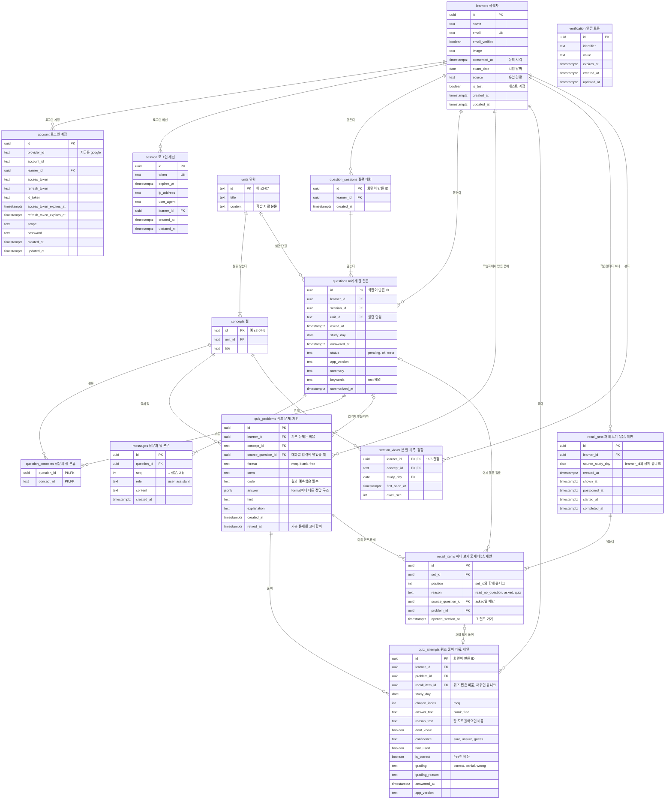

# 전체 DB 테이블 구조

지금 DB에 있는 테이블과, [4-79](https://linear.app/silo0/issue/4-79)에서 제안한 퀴즈와 꺼내 보기 테이블을 한 장의 ERD로 모은 문서예요. 기존 테이블은 `main` 브랜치 `0e5abcc` 커밋의 `lib/db/schema.ts`를 기준으로 했어요. 제안 테이블은 [퀴즈와 꺼내 보기 DB 스키마 설계 초안](2026-11-05-quiz-schema.md)을 따랐어요.

## 한눈에 보기

테이블은 모두 15개예요. 지금 있는 테이블 10개, 제안 테이블 4개, 정한 테이블 1개예요.

| 영역 | 테이블 | 한글 뜻 | 상태 |
| --- | --- | --- | --- |
| 학습자와 로그인 | `learners` | 학습자 | 있음 |
| | `account` | 로그인 계정 | 있음 |
| | `session` | 로그인 세션 | 있음 |
| | `verification` | 인증 토큰 | 있음 |
| 학습 자료 | `units` | 단원 | 있음 |
| | `concepts` | 절 | 있음 |
| AI에게 묻기 | `question_sessions` | 질문 대화 | 있음 |
| | `questions` | AI에게 한 질문 | 있음 |
| | `question_concepts` | 질문의 절 분류 | 있음 |
| | `messages` | 질문과 답 본문 | 있음 |
| 퀴즈와 꺼내 보기 | `quiz_problems` | 퀴즈 문제 | 제안 |
| | `quiz_attempts` | 퀴즈 풀이 기록 | 제안 |
| | `recall_sets` | 꺼내 보기 묶음 | 제안 |
| | `recall_items` | 꺼내 보기 출제 대상 | 제안 |
| | `section_views` | 본 절 기록 | 정함, 11/5 결정 문서 |

- **있음**은 지금 코드와 DB에 있는 테이블이에요.
- **제안**은 4-79에서 설계했지만 아직 코드에 넣지 않은 테이블이에요.
- **정함**은 PO가 결정 문서로 정했고 아직 DB에 적용하지 않은 테이블이에요. `section_views`는 [퀴즈 출제 방식과 본 절 기준](https://linear.app/silo0/document/퀴즈-출제-방식과-본-절-기준-115-결정-f391a8767d4f)에서 정했어요.

## ERD

테이블 제목 옆에 한글 뜻을 적었고, 제안과 정함 테이블은 제목 끝에 상태를 붙였어요.

다이어그램의 `PK`는 기본 키, `FK`는 다른 테이블을 가리키는 키, `UK`는 유니크 키예요.

## 영역별 설명

### 학습자와 로그인

`learners`가 모든 기록의 중심이에요. 거의 모든 테이블이 `learner_id`로 학습자를 가리켜요.

`account`, `session`, `verification`은 로그인 라이브러리인 Better Auth가 쓰는 테이블이에요. 지금 켜진 로그인 제공자는 Google 하나예요. `verification`은 다른 테이블과 연결되지 않아요. 근거와 자세한 내용은 [ADR 0004](../wiki/adr/0004-social-login.md)와 [소셜 로그인 설계 문서](2026-11-02-social-login-design.md)에 있어요.

### 학습 자료

`units`는 단원 5개, `concepts`는 절 24개예요. 절이 곧 개념이고, 절 ID는 `단원 ID-소제목 번호` 형식이에요. 예를 들어 `s2-07-5`는 조인 단원의 다섯 번째 소제목이에요. 두 테이블의 ID는 한 번 넣으면 바꾸지 않아요. 바꾸면 기존 질문과 문제가 다른 절을 가리키게 돼요.

### AI에게 묻기

학습자가 질문 창에서 새 대화를 만들면 `question_sessions`에 한 줄이 생겨요. 그 대화의 질문은 `questions`에, 질문과 답의 본문은 `messages`에 저장돼요. `question_concepts`는 질문이 어느 절에 대한 것인지 AI가 분류한 결과예요. 자세한 내용은 [질문 서버 문서](2026-11-03-question-server.md)와 [대화 세션 테이블 문서](2026-11-05-question-session-tables.md)에 있어요.

### 퀴즈와 꺼내 보기, 제안

- **`quiz_problems`** 에는 모든 문제가 저장돼요. 퀴즈 탭 문제, 꺼내 보기 문제, 기본 문제가 모두 여기 있어요.
- **`quiz_attempts`** 에는 학습자가 푼 답이 저장돼요. 퀴즈 탭과 꺼내 보기 풀이가 모두 여기에 쌓여요. 꺼내 보기 풀이만 `recall_item_id`를 채워요.
- **`recall_sets`** 는 하루 한 번 보여 주는 꺼내 보기의 한 회차예요.
- **`recall_items`** 는 그 회차에 낼 문제 세 개의 목록이에요. 문제를 담지 않고 `quiz_problems`를 가리키기만 해요.
- **`section_views`** 는 학습자가 학습 화면에서 본 절이에요. 꺼내 보기에 낼 "넘어간 절"을 계산할 때 써요. 호윤님이 11/5 결정 문서에서 정했어요.

테이블마다 왜 이렇게 설계했는지는 [설계 초안 문서](2026-11-05-quiz-schema.md)에 있어요. 퀴즈 탭과 꺼내 보기를 어떻게 구분하는지, 묶음과 출제 대상을 왜 나눴는지도 그 문서의 "헷갈리기 쉬운 것" 절에 있어요.

## 기존 테이블과 이어지는 곳

제안 테이블이 기존 테이블을 가리키는 곳은 네 군데예요. 기존 테이블에는 컬럼을 더하지 않아요.

| 제안 테이블의 컬럼 | 가리키는 기존 테이블 | 뜻 |
| --- | --- | --- |
| `learner_id` | `learners` | 누구의 문제, 풀이, 묶음, 본 절인지 |
| `concept_id` | `concepts` | 어느 절의 문제인지, 어느 절을 봤는지 |
| `quiz_problems.source_question_id` | `questions` | 문제를 만들 때 입력에 넣은 대화 |
| `recall_items.source_question_id` | `questions` | 꺼내 보기 화면에 보여 줄 어제 물은 질문 |

## 이 문서에서 다루지 않는 것

- 4-64에서 제안한 `questions.section_concept_id`와 `selected_text`는 아직 정해지지 않아서 넣지 않았어요.
- 제안 테이블의 이름은 바뀔 수 있어요. 설계 초안 문서의 정할 것에 `recall_rounds`, `recall_targets`로 바꾸는 안이 있어요.
