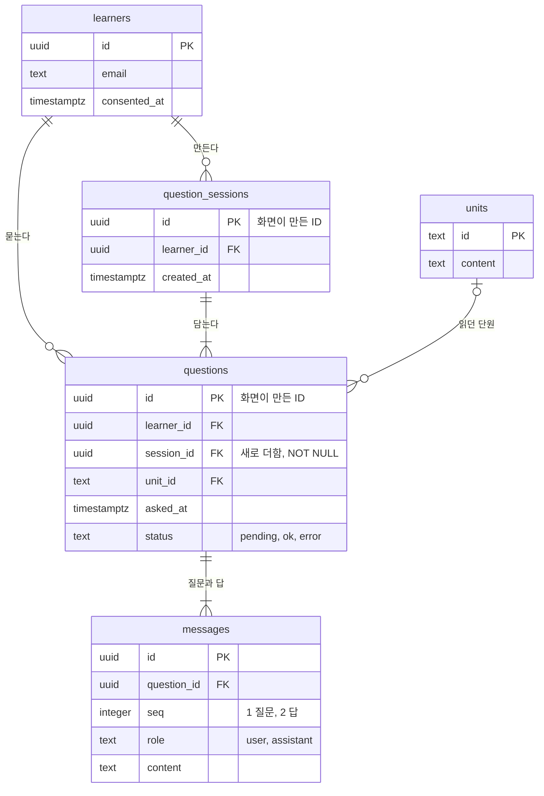
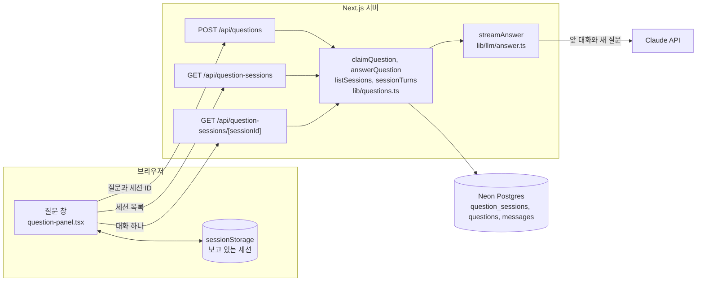
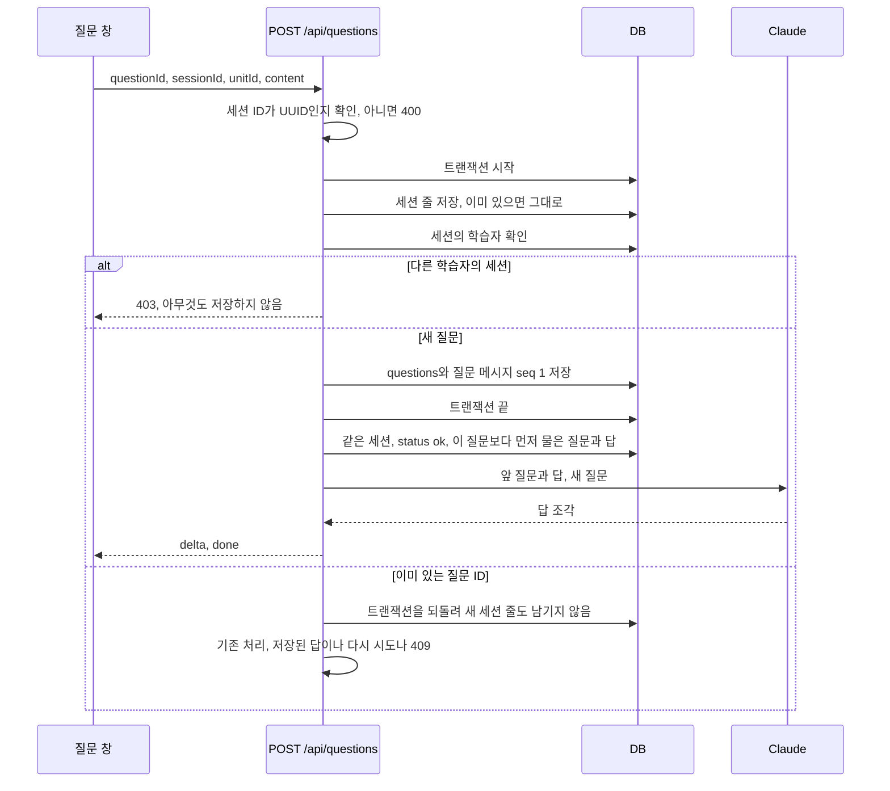
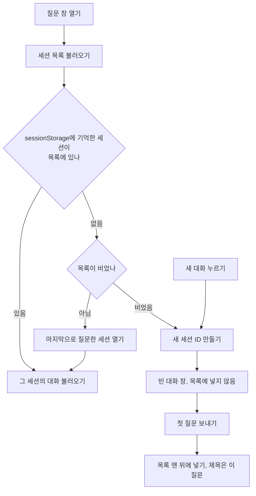

# 질문 창의 대화 세션을 저장하는 테이블 설계

Linear [4-77](https://linear.app/silo0/issue/4-77)에서 질문 창에 대화 세션을 더하면서 바꾼 DB 스키마와, 그 테이블을 쓰는 기능을 정리한 문서예요. 학습자는 새 대화를 만들고 대화를 오갈 수 있고, AI는 같은 대화의 앞 질문과 답을 알고 답해요. 기준은 2026-11-05 커밋하지 않은 `4-77` 브랜치 코드예요. 기존 저장 구조의 근거는 Linear 문서 [05-1 기록 구조 테이블 설계](https://linear.app/silo0/document/05-1-기록-구조-테이블-설계-0c3075a457c4)에, 질문 서버와 질문 창의 기존 동작은 [질문 서버 문서](2026-11-03-question-server.md)에, 테스트 기준은 [ADR 0006](../wiki/adr/0006-test-strategy.md)에 있어요.

## 한눈에 보기

- `question_sessions` 테이블을 새로 만들고, `questions`에 반드시 채워야 하는 `session_id`를 더했어요.
- 세션 ID는 화면이 `crypto.randomUUID()`로 만들어요. 서버는 그 세션의 첫 질문을 저장할 때 세션 줄도 함께 저장해요. "새 대화"를 누르기만 하면 DB에는 아무것도 생기지 않아요.
- 세션 제목과 마지막 질문 시각은 따로 저장하지 않고 질문 기록에서 만들어요. 제목은 그 대화의 첫 질문이고, 목록은 마지막으로 질문한 대화부터 놓여요.
- AI에게는 같은 세션에서 이 질문보다 먼저 묻고 답을 받은 질문과 답을 순서대로 넘겨요. 실패한 질문과 다른 세션의 대화는 넘기지 않아요.
- 다른 학습자의 세션 ID로 질문하면 403, 불러오면 404예요. 아무것도 저장하지 않아요.
- 기존 질문은 마이그레이션에서 학습자마다 대화 하나로 묶었어요.

## 테이블

`learners`, `units`, `messages`는 바꾸지 않았어요. 다이어그램에는 이번 기능에 쓰는 컬럼만 적었어요.

### `question_sessions`

| 컬럼 | 타입 | 뜻 |
| --- | --- | --- |
| `id` | `uuid` PK | 화면이 만든 세션 ID예요. 서버는 기본값을 만들지 않아요 |
| `learner_id` | `uuid` NOT NULL, FK `learners.id` | 세션을 만든 학습자예요. 질문을 보낼 때와 대화를 불러올 때 이 값으로 소유를 확인해요 |
| `created_at` | `timestamptz` NOT NULL, 기본값 `now()` | 세션 줄을 저장한 시각이에요 |

인덱스는 `question_sessions_learner_id_idx`예요. `questions`와 같이 학습자를 지워도 함께 지우지 않아요. 질문 내역을 지우지 않는다는 05-1 규칙을 따랐어요.

### `questions`에 더한 컬럼

| 컬럼 | 타입 | 뜻 |
| --- | --- | --- |
| `session_id` | `uuid` NOT NULL, FK `question_sessions.id` | 질문이 속한 세션이에요. 처음 저장한 뒤로는 바꾸지 않아요 |

인덱스 `questions_session_id_idx`를 더했어요. 앞 대화를 찾을 때와 세션 하나를 불러올 때 이 컬럼으로 찾아요.

### 따로 저장하지 않은 값

| 값 | 만드는 곳 | 저장하지 않은 이유 |
| --- | --- | --- |
| 세션 제목 | 세션에서 `asked_at`이 가장 이른 질문의 원문이에요. `lib/question-sessions.ts`의 `toSessionList`가 만들어요 | 첫 질문과 따로 저장하면 두 값이 어긋날 수 있어요 |
| 마지막 질문 시각 | 세션에서 가장 늦은 `asked_at`이에요 | 질문을 저장할 때마다 세션 줄을 고쳐야 하고, 동시에 온 질문끼리 같은 줄을 두고 다퉈요 |
| 지금 보고 있는 세션 | 브라우저 `sessionStorage`에 탭마다 기억해요 | 새로고침에는 남고, 새 탭에서는 마지막으로 질문한 대화로 열려야 해요 |

## 기존 질문 옮기기

`drizzle/0003_question_sessions.sql`은 이 순서로 바꿔요.

1. `question_sessions` 테이블을 만들어요.
2. `questions.session_id`를 빈 값을 허용하는 컬럼으로 더해요.
3. 질문이 있는 학습자마다 세션 줄을 하나 만들어요. `created_at`은 그 학습자의 첫 질문 시각이에요.
4. 학습자의 모든 질문을 그 세션에 넣어요.
5. `session_id`를 NOT NULL로 바꾸고 FK와 인덱스를 더해요.

세션이 생기기 전에는 대화를 나누는 기준이 없었어서, 개발자가 학습자마다 대화 하나로 묶기로 했어요. Neon `test` 브랜치에는 적용했고, 운영 브랜치에는 아직 적용하지 않았어요.

## 세션을 쓰는 기능

### 구조

| 파일 | 하는 일 |
| --- | --- |
| `lib/db/schema.ts` | `questionSession` 테이블과 `questions.sessionId`를 정의해요 |
| `lib/question-sessions.ts` | 질문 기록을 세션 목록으로 바꾸는 `toSessionList`와, 화면과 서버가 같이 쓰는 응답 타입이 있어요 |
| `lib/questions.ts` | 세션과 첫 질문을 함께 저장하고, 앞 대화를 모아 AI에게 넘기고, 세션 목록과 대화 하나를 읽어요 |
| `app/api/question-sessions/route.ts` | 로그인한 학습자의 세션 목록을 돌려줘요 |
| `app/api/question-sessions/[sessionId]/route.ts` | 세션 하나의 질문과 답을 돌려줘요. 학습자의 세션이 아니면 404예요 |
| `app/study/(unit)/_components/question-panel.tsx` | 세션 목록과 "새 대화"를 보여 주고, 모든 세션의 질문을 한곳에 두고 열린 세션의 질문만 보여 줘요 |

### 질문을 저장하고 앞 대화를 넘기는 흐름

앞 대화는 `asked_at`, 질문 ID, `seq` 순서로 모아요. 다시 시도해도 `asked_at`은 처음 값 그대로라서, 실패한 질문을 다시 보내면 그 질문보다 먼저 물은 대화까지만 넘어가요. 이미 있는 질문이 다른 세션 ID로 다시 와도 처음 저장한 세션에 그대로 남아요.

### 화면이 열 세션을 고르는 규칙

세션을 오갈 때는 이미 불러온 세션을 다시 불러오지 않아요. 답을 받는 중인 질문이 서버에서 읽은 내용에 덮이지 않게 하려는 거예요. 질문마다 세션 ID를 들고 있어서, 답을 받는 도중 다른 대화로 옮겨도 답은 질문한 대화에만 붙어요.

## 검토한 대안

모두 개발자가 4-77에서 정했어요.

| 대안 | 택하지 않은 이유 |
| --- | --- |
| 세션 테이블 없이 `questions.session_id`만 두기 | 첫 질문 전에는 세션의 주인을 알 수 없고, 다른 학습자의 세션 ID에 질문을 끼워 넣는 것을 FK와 소유 확인으로 막을 수 없어요 |
| "새 대화"를 누를 때 서버에 세션 만들기 | 질문 없는 빈 세션이 쌓이고, 목록에서 다시 걸러야 해요 |
| 세션 ID를 주소에 넣기 | 4-76에서 단원 안 위치를 주소에 넣는 작업과 겹쳐요 |
| 보고 있는 세션을 DB에 저장하기 | 탭마다 다른 대화를 볼 수 있어야 하고, 새 탭은 마지막으로 질문한 대화로 열려야 해요 |
| 앞 대화 길이 제한 | 이번 이슈에서는 하지 않기로 했어요. Linear 4-77의 하지 않는 것에 긴 대화 성능 최적화가 있어요 |

## 테스트

노션 Test-case DB에서 4-77에 연결된 확정 케이스 11개를 모두 테스트로 옮겼고 모두 통과했어요.

| 케이스 | 유형 | 확인하는 것 |
| --- | --- | --- |
| TC-75 | 통합 | 새 세션 ID로 첫 질문을 보내면 세션 줄이 하나 생기고, 다음 질문도 그 세션에 저장돼요 |
| TC-76 | 통합 | 다른 학습자의 세션 ID로 보내면 403이고 질문, 메시지, 세션이 그대로예요 |
| TC-77 | E2E | 이전 대화로 돌아가면 그 대화만 보이고, 새로고침하면 보던 대화가, 새 탭은 마지막으로 질문한 대화가 열려요 |
| TC-78 | E2E | 다른 학습자의 대화는 목록에 없고, 직접 불러와도 거부돼요 |
| TC-79 | E2E | 답을 받는 도중 다른 대화로 옮겨도 답은 질문한 대화에만 붙어요 |
| TC-80 | E2E | 단원을 바꿔도 대화와 세션 목록이 그대로예요 |
| TC-81 | 통합 | 실패한 질문을 다른 세션 ID로 다시 보내도 처음 세션에 남아요 |
| TC-82 | 단위 | 목록은 마지막으로 질문한 대화부터 놓이고, 제목은 첫 질문이에요 |
| TC-83 | 통합 | 세션 ID가 없거나 UUID가 아니면 400이고 아무것도 저장하지 않아요 |
| TC-84 | 통합 | 같은 세션의 답을 받은 질문과 답만 순서대로 AI에게 넘겨요 |
| TC-85 | 통합 | 실패한 질문을 다시 보내면 그 질문보다 먼저 물은 대화만 넘겨요 |

`session_id`가 필수가 되면서 기존 통합 테스트의 `ask` 헬퍼가 요청마다 새 세션 ID를 보내게 바꿨어요. 질문을 DB에 직접 넣는 TC-36과 TC-50은 준비 단계에 세션 줄을 더했고, 확인하는 내용은 바꾸지 않았어요. E2E는 질문 요청을 가로채므로, TC-77은 가로챈 요청에서 질문과 답을 DB에 직접 저장해 서버가 저장한 결과를 흉내 내요. 전체 결과는 단위 12건, 통합 36건, E2E 19건이 통과했고 `npm run check`도 통과했어요.

## 남은 것

| 항목 | 지금 상태 | 제안 |
| --- | --- | --- |
| 운영 브랜치 마이그레이션 | `test` 브랜치에만 적용했어요 | 배포 전에 운영 브랜치에 적용해요 |
| 기존 질문을 묶은 대화의 길이 | 질문이 많은 학습자는 배포 뒤 그 대화에서 물을 때 지난 질문과 답이 모두 AI에게 넘어가요. 비용이 늘고, 길면 컨텍스트 한도를 넘을 수 있어요 | 운영 데이터 양을 보고, 많으면 기존 질문을 학습일마다 나누거나 앞 대화 길이 제한을 정해요 |
| 답하는 중에 새로고침 | 서버에서 아직 `pending`인 질문이 실패로 보여요. 다시 시도하면 409 뒤 새 질문 ID로 같은 질문이 하나 더 생겨요 | 불러온 질문의 상태를 화면에 넘겨 답하는 중으로 보여 줘요. 노션 케이스가 먼저 필요해요 |
| 세션 목록을 불러오지 못할 때 | 안내 없이 빈 목록과 새 대화로 열려요. 데이터는 잃지 않아요 | 오류 UI를 정할 때 함께 정해요 |
