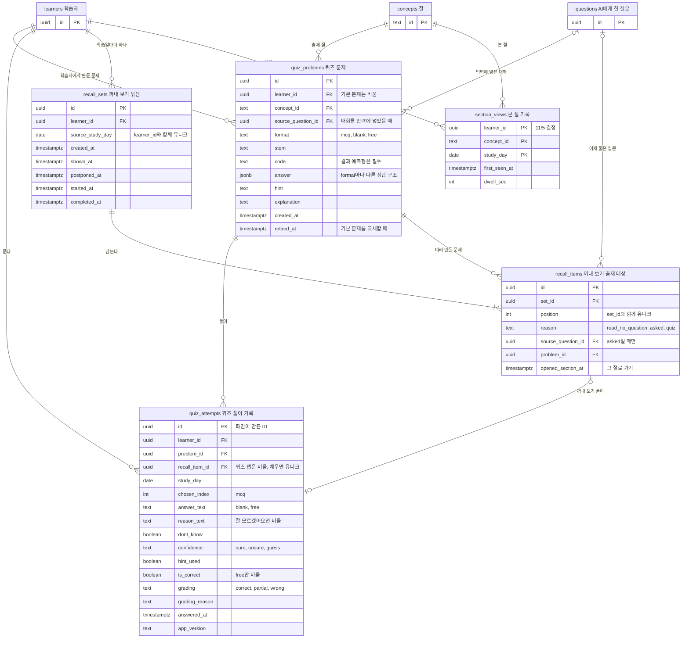
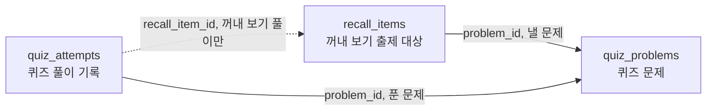
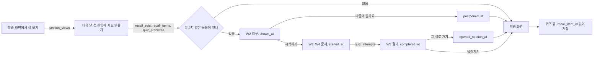

# 퀴즈와 꺼내 보기 DB 스키마 설계 초안

Linear [4-79](https://linear.app/silo0/issue/4-79)에서 퀴즈 탭과 꺼내 보기가 함께 쓸 퀴즈 데이터를 DB 스키마로 정리한 문서예요. 아직 코드에 넣지 않은 **제안** 단계이고, 개발자가 회의 결정과 와이어프레임을 바탕으로 만들었어요. 초안을 만든 뒤 독립 리뷰를 한 번 거쳤고, 받아들인 지적과 받아들이지 않은 지적을 아래에 함께 적었어요.

기준 자료는 다음과 같아요.

- 회의 결정은 Linear 문서 [회의록_11/05_오전](https://linear.app/silo0/document/회의록-1105-오전-05fcd6885917)과 4-79 이슈 본문이에요. 4-79 본문은 2026-11-05 16:28 갱신본을 기준으로 했어요.
- 출제 방식과 본 절 기준은 [4-82](https://linear.app/silo0/issue/4-82)의 "정한 것", 기록 항목은 [4-64](https://linear.app/silo0/issue/4-64), 문제 출처는 [4-69](https://linear.app/silo0/issue/4-69)예요.
- 화면은 피그마 [와이어프레임 페이지](https://www.figma.com/design/T6FMSBSsut3ImxtoCUB3YO/-PJ4--%EB%A8%BC%EC%9E%91%EA%B7%80?node-id=117-2)와 디자인 레포 `silo-4th/silo-4th-design`의 `453eeb9` 커밋이에요. 와이어프레임은 11/4 회의 기준이라, 11/5 회의에서 바뀐 부분은 회의록을 따랐어요.
- 지금 스키마는 `lib/db/schema.ts`이고, 질문과 대화 세션 테이블은 [대화 세션 테이블 문서](2026-11-05-question-session-tables.md)에 있어요.

## 한눈에 보기

- 테이블 다섯 개를 새로 만들어요. `quiz_problems` (퀴즈 문제), `quiz_attempts` (퀴즈 풀이 기록), `recall_sets` (꺼내 보기 묶음), `recall_items` (꺼내 보기 출제 대상), `section_views` (본 절 기록)예요.
- `section_views`는 호윤님이 11/5 결정 문서 [퀴즈 출제 방식과 본 절 기준](https://linear.app/silo0/document/퀴즈-출제-방식과-본-절-기준-115-결정-f391a8767d4f)에서 정한 테이블이에요.
- 모든 문제는 같은 AI가 절 본문으로 만들어요. 기본 문제는 학습자가 없는 문제이고, 학습자에게 만든 문제와 같은 테이블, 같은 형식을 써요.
- 퀴즈 탭 풀이와 꺼내 보기 풀이는 같은 `quiz_attempts`에 쌓고, 꺼내 보기 풀이만 `recall_item_id`를 채워요.
- 정답 구조는 문제 유형마다 달라서 `answer` jsonb 하나에 담아요.
- 꺼내 보기의 진행 상태와 결과 판정은 저장하지 않고 시각 컬럼과 풀이 기록에서 계산해요.

## 전체 구조

테이블 이름 옆에 한글 뜻을 적었어요.

`learners` (학습자), `concepts` (절), `questions` (AI에게 한 질문)는 바꾸지 않아요. 다이어그램에는 이 세 테이블의 `id`만 적었어요.

## 헷갈리기 쉬운 것

### 문제는 어디에 저장되나요

모든 문제는 `quiz_problems` (퀴즈 문제)에만 저장해요. 퀴즈 탭 문제도, 꺼내 보기 문제도, 기본 문제도 모두 여기 있어요. 다른 테이블은 `problem_id`로 이 문제를 가리키기만 해요.

| 테이블 | 담는 것 | 퀴즈 탭 | 꺼내 보기 |
| --- | --- | --- | --- |
| `quiz_problems` (퀴즈 문제) | 문제 자체. 문장, 보기, 정답, 힌트, 해설 | 씀 | 씀 |
| `recall_sets` (꺼내 보기 묶음), `recall_items` (꺼내 보기 출제 대상) | 꺼내 보기에서 어떤 문제를 어떤 이유로 몇 번째에 냈는지 | 안 씀 | 씀 |
| `quiz_attempts` (퀴즈 풀이 기록) | 학습자가 푼 답 | 씀 | 씀 |

`recall_items`는 문제를 담지 않아요. 꺼내 보기의 출제 목록이고, 꺼내 보기 풀이도 `quiz_attempts`에 저장해요.

### 퀴즈 탭 문제인지 꺼내 보기 문제인지 어떻게 구분하나요

`quiz_problems`에는 구분하는 값이 없어요. 같은 기본 문제가 퀴즈 탭과 꺼내 보기에 모두 나올 수 있어서, 문제에 용도를 적으면 다른 쪽에서 쓴 순간 틀린 값이 돼요. 4-82 정한 것 1에 따라 모든 문제를 같은 AI가 같은 방식으로 만들기 때문에, 만드는 단계에서도 구분할 필요가 없어요.

대신 어디서 냈는지와 어디서 풀었는지로 구분해요.

| 알고 싶은 것 | 보는 곳 |
| --- | --- |
| 이 풀이가 꺼내 보기 풀이인가 | `quiz_attempts.recall_item_id`가 채워져 있으면 꺼내 보기, 비어 있으면 퀴즈 탭 |
| 이 문제가 꺼내 보기에 나간 적 있나 | `recall_items.problem_id`로 이 문제를 가리키는 행이 있는지 |
| 꺼내 보기 문제만 모아 보기 | `recall_items`와 `quiz_problems` 조인 |
| 기본 문제를 꺼냈는가 | 문제의 `learner_id`가 비었는지 |

나중에 두 화면의 문제를 다르게 만들기로 하면, 예를 들어 꺼내 보기 문제만 정답 검증을 한 번 더 하거나 프롬프트를 다르게 쓰면, 그때 AI가 만든 문제에만 `generated_for` 같은 컬럼을 더해요.

### 꺼내 보기 묶음과 출제 대상을 왜 나눴나요

꺼내 보기에는 묶음 전체에 한 번만 일어나는 일과 문항마다 일어나는 일이 섞여 있어요.

| 행동 | 단위 | 저장하는 곳 |
| --- | --- | --- |
| 입구 화면을 봤다 | 묶음 한 번 | `recall_sets.shown_at` |
| 나중에 할게요를 눌렀다 | 묶음 한 번 | `recall_sets.postponed_at` |
| 시작하기를 눌렀다 | 묶음 한 번 | `recall_sets.started_at` |
| 문제를 풀었다 | 문항마다 | `quiz_attempts` |
| 그 절로 가기를 눌렀다 | 문항마다 | `recall_items.opened_section_at` |
| 결과 화면까지 갔다 | 묶음 한 번 | `recall_sets.completed_at` |

두 테이블을 합치면 묶음 값이 문항 세 줄에 복사돼요. 나중에 할게요를 누를 때마다 세 줄을 함께 고쳐야 하고, 하나만 고쳐지면 같은 회차가 미뤘으면서 안 미룬 상태가 돼요. 완료율을 셀 때도 문항을 회차 단위로 다시 묶어야 해요.

**합쳐도 되는 조건이 하나 있어요.** 입구를 봤는지와 미뤘는지를 앰플리튜드 이벤트로만 남기기로 하면, 시작과 완료는 풀이 기록에서 계산할 수 있어요. 첫 문항을 풀었으면 시작한 것이고, 세 문항을 다 풀었으면 끝낸 거예요. 그러면 회차 단위로 남길 값이 근거 학습일 하나뿐이라 테이블을 하나로 합치는 편이 단순해요. 4-64의 완료율 분모가 "보여 준 회차"라서 이 초안은 DB에 남기는 쪽을 택했어요.

## 테이블

### `quiz_problems` (퀴즈 문제)

| 컬럼 | 타입 | 뜻 | 근거 |
| --- | --- | --- | --- |
| `id` | `uuid` PK | 문제 ID예요 | |
| `learner_id` | `uuid` FK `learners.id` | 이 학습자에게 만든 문제예요. 비어 있으면 기본 문제예요 | 꺼내 보기 문제는 학습일이 끝난 뒤 학습자가 처음 들어올 때 만들어요. 4-104 |
| `concept_id` | `text` NOT NULL, FK `concepts.id` | 문제가 묻는 절이에요. 단원은 `concepts.unit_id`로 구해요 | 4-82 이미 정한 것 "절 = 개념", 회의록 "단원 ID는 출제 기능을 만들 때 정해요" |
| `source_question_id` | `uuid` FK `questions.id` | 문제를 만들 때 입력에 넣은 대화예요. 채우면 `learner_id`도 채워야 해요 | 4-82 정한 것 1 "어제 물어본 절은 그 대화를 입력에 더해서" |
| `format` | `text` NOT NULL, `mcq` / `blank` / `free` | 객관식, 빈칸, 서술이에요. 결과 예측형은 `mcq`에 코드가 붙은 문제예요 | 회의록 "문제 유형은 데이터에는 남겨요", 4-64 착각 비율은 `mcq`, `blank`만 써요 |
| `stem` | `text` NOT NULL | 문제 문장이에요. 빈칸 문제는 빈칸 자리를 `____`로 표시해요 | 4-79 데이터 형식 초안 |
| `code` | `text` | 예제 코드예요 | 디자인 레포 `Question.code`, 피그마 W3 "예제 코드" |
| `answer` | `jsonb` NOT NULL | format마다 다른 정답 구조예요. 아래 표를 보세요 | 4-79 초안의 `choices`, `answer`, `rubric` |
| `hint` | `text` NOT NULL | 힌트 하나예요 | 회의록 3번 "힌트는 하나로 고정해요" |
| `explanation` | `text` NOT NULL | 해설이에요. 맞혔을 때와 틀렸을 때 같은 해설을 보여 줘요 | 회의록 4번 |
| `created_at` | `timestamptz` NOT NULL | 만든 시각이에요 | |
| `retired_at` | `timestamptz` | 더 이상 내지 않는 문제예요. 기본 문제에 오류가 있으면 행을 고치지 않고 이 값을 채운 뒤 새 행을 넣어요 | 4-82 정한 것 2 "공개 전에 정답을 한 번 확인해요", 리뷰 지적 10 |

`answer` 안의 구조예요. TS에서는 `format`으로 나뉘는 판별 유니온으로 두고, AI 응답을 저장하기 전에 서버에서 이 구조인지 검증해요.

| format | `answer` 내용 | 근거 |
| --- | --- | --- |
| `mcq` | `choices` 보기 배열과 `answerIndex`. 보기마다 `text`와 선택값 `misconception`을 둬요 | 디자인 레포 `options`, `answer` |
| `blank` | `accepted` 정답으로 인정할 말 목록 | 11/4 프로토타입 문서 "비슷한 말을 여러 개 미리 정해 두고 비교해요" |
| `free` | `modelAnswer` 모범 답과 `keyPoints` 핵심 요소 목록 | 4-79 초안의 `rubric` |

### `quiz_attempts` (퀴즈 풀이 기록)

| 컬럼 | 타입 | 뜻 | 근거 |
| --- | --- | --- | --- |
| `id` | `uuid` PK | 화면이 만든 ID예요. 같은 ID로 다시 오면 한 건만 남겨요 | `questions.id`와 같은 규칙 |
| `learner_id` | `uuid` NOT NULL, FK | 푼 학습자예요 | 4-64 퀴즈 기록 |
| `problem_id` | `uuid` NOT NULL, FK | 푼 문제예요. 기본 문제를 꺼냈는지는 이 문제의 `learner_id`가 비었는지로 알아요 | 4-79 초안 "미리 만든 기본 문제를 꺼냈는지도 남겨요" |
| `recall_item_id` | `uuid` FK `recall_items.id` | 꺼내 보기에서 푼 문항이에요. 퀴즈 탭 풀이는 비워요. 채운 값은 유니크라서 한 문항에 풀이가 하나만 남아요 | 회의록 10번 "저장할 때 구분해요", 리뷰 지적 4 |
| `study_day` | `date` NOT NULL | 푼 학습일이에요 | `questions.study_day`와 같은 기준 |
| `chosen_index` | `integer` | 객관식에서 고른 보기예요 | 4-64의 `chosen_index` |
| `answer_text` | `text` | 빈칸과 서술에서 쓴 답이에요 | 4-64의 `answer_text` |
| `reason_text` | `text` | 답을 고른 이유예요. 잘 모르겠어요를 누르면 비어요 | 회의록 3번 "답 설명 입력은 필수" |
| `dont_know` | `boolean` NOT NULL | 잘 모르겠어요를 눌렀는지예요 | 회의록 3번, 피그마 W3 |
| `confidence` | `text`, `sure` / `unsure` / `guess` | 이유를 보낸 뒤 고른 확신도예요. 잘 모르겠어요면 비어요 | 회의록 3번 "선택지 세 개" |
| `hint_used` | `boolean` NOT NULL | 힌트를 봤는지예요 | 4-64의 `hint_used` |
| `is_correct` | `boolean` | 정답 여부예요. 객관식과 빈칸은 잘 모르겠어요도 `false`로 저장하고, 서술만 비워요 | 4-64 "자유 설명은 비워 둘 수 있어요", 리뷰 지적 8 |
| `grading` | `text`, `correct` / `partial` / `wrong` | 서술의 AI 판정이에요 | 4-64의 `grading` |
| `grading_reason` | `text` | AI 판정 근거예요 | 4-64의 `grading_reason` |
| `answered_at` | `timestamptz` NOT NULL | 답한 시각이에요 | 4-64 |
| `app_version` | `text` NOT NULL | 답할 때의 앱 버전이에요. `env.APP_VERSION`에서 읽어요 | `questions.app_version`과 같은 규칙, 리뷰 지적 14 |

DB가 거는 CHECK는 `dont_know`가 참이면 `reason_text`와 `confidence`가 비어 있어야 한다는 것 하나예요. format에 따라 어떤 답 컬럼이 채워져야 하는지는 서버가 문제를 읽고 확인해요.

### `recall_sets` (꺼내 보기 묶음)

| 컬럼 | 타입 | 뜻 | 근거 |
| --- | --- | --- | --- |
| `id` | `uuid` PK | | |
| `learner_id` | `uuid` NOT NULL, FK | | |
| `source_study_day` | `date` NOT NULL | 근거가 된 학습일, 화면의 "어제"예요. `learner_id`와 함께 유니크라서 학습일마다 묶음이 하나만 생겨요 | 4-64의 `source_study_day`, 4-82 제안 "꺼내 보기는 직전 학습일", 리뷰 지적 3 |
| `created_at` | `timestamptz` NOT NULL | 세트를 만든 시각이에요 | 4-104 다음 날 첫 진입 |
| `shown_at` | `timestamptz` | 입구 화면을 처음 보여 준 시각이에요 | 4-64 status `shown`, 피그마 W2, 리뷰 지적 2 |
| `postponed_at` | `timestamptz` | 나중에 할게요를 누른 시각이에요 | 피그마 W2 "나중에 할게요" |
| `started_at` | `timestamptz` | 시작하기를 누른 시각이에요 | 피그마 W2 "시작하기" |
| `completed_at` | `timestamptz` | 결과 화면까지 간 시각이에요 | 핵심 지표 "다음 날 꺼내 보기 완료율" |

### `recall_items` (꺼내 보기 출제 대상)

| 컬럼 | 타입 | 뜻 | 근거 |
| --- | --- | --- | --- |
| `id` | `uuid` PK | | |
| `set_id` | `uuid` NOT NULL, FK `recall_sets.id` | | |
| `position` | `integer` NOT NULL | 보여 줄 순서예요. `set_id`와 함께 유니크예요 | 피그마 W3 "1 / 3" |
| `reason` | `text` NOT NULL, `read_no_question` / `asked` / `quiz` | 이 절을 낸 이유예요. 채운 절 값은 4-82가 정해지면 더해요 | 4-64의 `reason`, 4-70 결정, 피그마 W2 "넘어감", "물어봄", 리뷰 지적 9 |
| `source_question_id` | `uuid` FK `questions.id` | 어제 물은 질문이에요. `reason`이 `asked`일 때만 채워요 | 피그마 W4 "어제 이렇게 물으셨어요", 4-69 "질문 원문으로 묻기로 했어요" |
| `problem_id` | `uuid` NOT NULL, FK | 세트를 만들 때 정한 문제예요. 절은 이 문제의 `concept_id`예요 | 4-104 |
| `opened_section_at` | `timestamptz` | 결과 화면에서 그 절로 가기를 누른 시각이에요 | 피그마 기록 흐름 4단계 "답, 확신, 이동 여부를 남겨 다음 출제에 써요" |

### `section_views` (본 절 기록)

> **정했어요.** 호윤님이 11/5 결정 문서 [퀴즈 출제 방식과 본 절 기준](https://linear.app/silo0/document/퀴즈-출제-방식과-본-절-기준-115-결정-f391a8767d4f)의 정한 것 3에서 테이블과 컬럼을 정했어요. 이벤트 로그는 앰플리튜드로 보내는 것이 원칙이지만, 이 기록은 출제 범위를 계산하는 데 써서 DB에 남겨요.

| 컬럼 | 타입 | 뜻 | 근거 |
| --- | --- | --- | --- |
| `learner_id` | `uuid` NOT NULL, FK | 복합 PK의 하나예요 | 4-79 "출제 방식과 본 절 기록", 4-82 정한 것 3 |
| `concept_id` | `text` NOT NULL, FK | 본 절이에요 | 같은 근거 |
| `study_day` | `date` NOT NULL | 본 학습일이에요. 세 컬럼이 복합 PK라서 절마다 하루 한 줄이에요 | 4-82 "절마다 하루 한 줄을 남겨요" |
| `first_seen_at` | `timestamptz` NOT NULL | 그날 처음 본 시각이에요 | 같은 근거 |
| `dwell_sec` | `integer` NOT NULL, 기본값 0 | 지금 읽는 절로 머문 시간 합계예요. 판정에는 쓰지 않고 첫 주 분석에만 써요 | 같은 근거 |

기록 기준은 결정 문서를 따라요.

- 절 소제목이 화면 맨 위에 닿으면 그 절을 본 것으로 기록해요.
- 마지막 절은 페이지 맨 아래에 닿으면 기록해요.
- 절 주소로 바로 이동하면 그 절만 기록해요.
- 빠르게 훑고 지나간 절도 본 절이에요.

## 이렇게 설계한 근거

### 문제와 풀이를 나눴어요

기본 문제는 여러 학습자에게, 퀴즈 탭과 꺼내 보기 양쪽에 나와요. 문제와 풀이를 한 줄에 두면 기본 문제가 풀 때마다 복사돼요. 그래서 문제는 한 번만 저장하고 풀이가 문제를 가리켜요. 4-79 초안은 `context`를 문제 형식에 넣었지만, 어디서 풀었는지는 풀이의 속성이라 `quiz_attempts`로 옮겼어요.

이렇게 하면 4-64 퀴즈 기록의 `problem_id`와 `question_text`를 나눠 저장할 필요도 없어요. 모든 문제가 `quiz_problems`의 한 행이기 때문이에요.

### 기본 문제와 학습자 문제를 한 테이블에 뒀어요

4-82 정한 것 2는 기본 문제도 같은 AI로 절 24개마다 미리 만든다고 정했어요. 만드는 방식과 형식이 같으니 테이블을 나눌 이유가 없어요. 기본 문제인지는 `learner_id`가 비었는지로 구분하고, 따로 플래그를 두지 않아요.

### 정답 구조는 jsonb 하나에 담았어요

객관식의 보기, 빈칸의 정답 후보, 서술의 모범 답은 서로 겹치는 필드가 없어요. 컬럼으로 풀면 `choices`, `answer_index`, `accepted_answers`, `rubric` 네 컬럼이 format마다 대부분 비고, 어떤 컬럼이 채워져야 하는지 CHECK 세 개로 지켜야 해요. 정답 구조를 SQL로 조회할 일도 없어요. 지표에 쓰는 `format`, `is_correct`, `confidence`는 컬럼으로 남겼어요.

대신 DB가 `answer` 내용을 검증하지 않아요. 그래서 AI 응답을 저장하기 전에 서버에서 검증하는 것을 이 구조의 조건으로 둬요.

### 꺼내 보기는 묶음과 문항으로 나눴어요

피그마 W2는 "어제 공부한 것 중 3개"를 미리 정해서 보여 주고, 4-64는 출제 대상을 학습자가 들어오기 전에 계산해 두기로 했어요. 그래서 학습자가 오기 전에 저장할 곳이 필요해요. 묶음 전체의 값인 근거 학습일과 진행 시각은 `recall_sets`에, 문항마다 다른 값인 낸 이유, 질문 원문, 그 절로 갔는지는 `recall_items`에 둬요.

묶음의 유니크 키는 보여 줄 날이 아니라 근거 학습일이에요. 월요일에 공부하고 화요일을 건너뛴 학습자가 수요일에 오면, 월요일 묶음을 그대로 보여 주면 돼요. 보여 줄 날로 키를 잡으면 화요일 묶음은 버려지고 수요일에는 "어제" 기록이 없어서 묶음이 생기지 않아요.

4-64는 꺼내 보기 결과를 `check_attempts`로 따로 두는 안이었어요. 답의 모양이 퀴즈 탭과 같고 회의에서 퀴즈 컴포넌트를 그대로 쓰기로 했으므로, 풀이는 `quiz_attempts` 하나에 두고 꺼내 보기에만 있는 값을 묶음과 문항으로 뺐어요.

### 상태 대신 시각을 남겼어요

`status` 하나로 두면 나중에 할게요를 누른 묶음을 다시 시작할 때 `postponed`가 `started`로 덮여서 미룬 이력이 사라져요. 입구를 띄운 뒤 탭을 닫은 학습자와 아예 오지 않은 학습자도 구분되지 않아요. 단계마다 시각을 남기면 이력이 남고, 지금 상태는 채워진 마지막 시각으로 계산해요.

### `context` 대신 `recall_item_id`를 뒀어요

꺼내 보기 풀이는 어느 문항을 풀었는지 가리켜야 해요. 이 FK가 있으면 퀴즈 탭인지 꺼내 보기인지는 FK가 비었는지로 알 수 있어요. `context`를 따로 두면 `context`는 퀴즈 탭인데 문항이 채워진 줄처럼 두 값이 어긋날 수 있어요.

### 같은 값을 두 곳에 두지 않았어요

| 값 | 구하는 방법 | 따로 저장하지 않은 이유 |
| --- | --- | --- |
| 꺼내 보기 진행 상태 | `recall_sets`의 시각 컬럼 | 위 "상태 대신 시각을 남겼어요" |
| 꺼내 보기 결과 판정 | `is_correct`, `confidence`, `dont_know`, `grading`으로 정하는 함수 하나 | 판정 규칙이 아직 정해지지 않았어요. 저장하면 규칙이 바뀔 때 기존 값을 다시 계산해야 해요 |
| 오답 태그 | 디자인 레포 `tagFor`처럼 정답 여부와 확신도로 정해요 | 같은 이유예요 |
| 풀이와 문항의 절 | `quiz_problems.concept_id`로 조인해요 | 두 곳에 두면 문제의 절과 어긋날 수 있어요 |
| 기본 문제를 꺼냈는지 | 문제의 `learner_id`가 비었는지 | 같은 이유예요 |
| 퀴즈에서 틀린 절 | `quiz_attempts`에서 조회해요 | 피그마 기록 흐름 2단계가 쓰는 값이지만 이미 있는 기록이에요 |

### 넣지 않은 값

| 값 | 근거 |
| --- | --- |
| 난이도 | 회의록 4번 "난이도는 빼요" |
| 두 번째 힌트 | 회의록 3번 "힌트는 하나로 고정해요" |
| 재출제 묶음 `family` | 디자인 레포에만 있는 값이고, 재출제는 이번 범위 밖이에요 |
| OX 유형 | 정한 유형은 객관식, 빈칸, 서술이에요. OX는 보기 두 개인 객관식으로 표현해요 |
| 단원 ID | 회의록 4번 "단원 ID는 아직 미정", `concept_id`로 구할 수 있어요 |
| 고민 시간, 지운 글자 수, 음성 입력 여부 | 회의록 7번 "이벤트 로그는 앰플리튜드로" |
| 문제 다시 뽑기 여부 | 4-74에서 11/5에 버튼을 정했어요. 지표에 쓰지 않아서 교체된 문제와 풀지 않은 문제를 구분하지 않기로 개발자가 11/5에 정했어요 |

## 독립 리뷰 반영

초안을 다른 에이전트가 Linear 이슈, 피그마, 코드를 직접 읽고 검토했어요. 지적 16개를 이렇게 처리했어요.

| 지적 | 처리 |
| --- | --- |
| 1. 본 절 기록 테이블이 없어 넘어간 절을 계산할 수 없어요 | `section_views`를 더했어요. 처음에는 개발자가 4-79와 4-82를 보고 넣었고, 호윤님이 11/5 결정 문서에서 같은 컬럼으로 정했어요 |
| 2. 묶음에 보여 준 시각이 없어 완료율 분모를 구할 수 없어요 | 반영했어요. `status`를 시각 네 개로 바꿨어요 |
| 3. 보여 줄 날을 키로 잡으면 하루를 건너뛴 학습자의 묶음이 꼬여요 | 반영했어요. 유니크 키를 `source_study_day`로 바꿨어요 |
| 4. 재시도나 탭 두 개로 풀이와 문항이 중복돼요 | 반영했어요. `recall_item_id` 유니크와 `(set_id, position)` 유니크를 걸고, 묶음과 문항은 한 트랜잭션으로 넣어요 |
| 5. 새벽 계산 시각이 학습일 경계와 겹쳐요 | 구현 주의로 남겼어요. 스키마가 아니라 계산 작업의 문제예요 |
| 6. 문항과 풀이의 `problem_id`, 문항과 문제의 절이 어긋날 수 있어요 | 절은 문항에서 빼서 해결했어요. `problem_id`는 처음에 규칙으로만 막았지만, PR 리뷰에서 다시 보고 복합 FK `(recall_item_id, problem_id)`를 걸었어요. 제약 두 개면 되고, 어긋난 기록은 오답률을 조용히 틀리게 만들기 때문이에요 |
| 7. 풀이에 `format`이 없어 format별 CHECK를 걸 수 없어요 | 받아들이지 않았어요. `format`을 복사하면 복합 FK가 필요해지고, 착각 비율은 조인 한 번이면 구해요. 답 컬럼 확인은 서버가 해요 |
| 8. `is_correct`의 빈 값이 세 가지 뜻이에요 | 반영했어요. 객관식과 빈칸은 잘 모르겠어요도 `false`로 저장하고, 서술만 비워요 |
| 9. `source`의 뜻과 `reason` 값 이름이 이슈와 달라요 | 반영했어요. 4-79 갱신본에서 `source`가 출제 이유로 바뀌어서, 문제에서는 `source`를 빼고 `source_question_id`만 남겼어요. 출제 이유는 `recall_items.reason`에 4-64 이름으로 둬요. 학습 화면 퀴즈 풀이에는 출제 이유를 남기지 않고 꺼내 보기에만 남기기로 개발자가 11/5에 정했어요 |
| 10. 기본 문제에 오류가 있어도 고칠 방법이 없어요 | 반영했어요. `retired_at`을 더하고 행은 고치지 않아요 |
| 11. 결과 판정 규칙이 정해지지 않았어요 | 판정 함수 하나로 두고 단위 테스트를 붙여요. 규칙은 아래 정할 것에 남겼어요 |
| 12. 서술은 답 자체가 설명이라 이유를 두 번 받게 돼요 | 정할 것으로 남겼어요. 화면 흐름의 결정이에요 |
| 13. 오답 태그를 지금 구조로 만들 수 없어요 | 이미 범위 밖으로 뺀 값이라 바꾸지 않았어요 |
| 14. `app_version`은 기존 규칙대로 넣으면 돼요 | 반영했어요 |
| 15. 확신도 문구가 두 벌이에요 | 값은 그대로 두고 문구만 정할 것으로 남겼어요 |
| 16. 4-64의 `questions.section_concept_id`, `selected_text`가 빠졌어요 | 질문 테이블의 변경이라 이번 퀴즈 스키마 범위 밖으로 두고 정할 것에 남겼어요 |

## 화면과 데이터 대조

| 화면에 필요한 것 | 화면 | 담는 곳 |
| --- | --- | --- |
| 꺼내 볼 절 세 개 | W2 | `recall_items`, 절은 문제의 `concept_id` |
| 넘어감, 물어봄 표시 | W2 | `recall_items.reason` |
| "어제 3절을 읽고" | W3 | `recall_sets.source_study_day` |
| 진행도 | W3, W4 | `recall_items.position` |
| 질문 원문 | W4 | `recall_items.source_question_id`로 `messages`의 첫 질문을 찾아요 |
| 문제 문장, 코드, 보기 | W3, W4 | `quiz_problems` |
| 잘 모르겠어요, 확신도 | W3 | `quiz_attempts.dont_know`, `confidence` |
| 개념별 판정 | W5 | 판정 함수 |
| 내 답과 실제 개념 | W5 | `quiz_attempts`의 답, `quiz_problems.explanation` |
| 그 절로 가기와 이동 여부 | W5 | 문제의 `concept_id`, `recall_items.opened_section_at` |
| 퀴즈 모아보기 | 왼쪽 메뉴 | `quiz_attempts`와 `quiz_problems` 조인 |

질문 원문은 문제가 아니라 문항에 붙였어요. 물어본 절의 문제를 그 자리에서 만들지 못해 기본 문제로 대신하면 문제에는 근거 질문이 없지만, 화면은 질문 원문을 보여 줘야 하기 때문이에요.

## 구현할 때 지킬 것

- AI가 만든 문제는 `answer` 구조를 서버에서 검증한 뒤에만 저장해요.
- 세트는 다음 날 첫 진입의 세트 준비 요청에서 만들어요. 문제를 모두 만든 뒤 묶음, AI가 만든 문제, 문항을 한 트랜잭션으로 넣어요. 다시 요청하거나 탭 두 개로 동시에 요청해도 `(learner_id, source_study_day)` 유니크 때문에 묶음이 하나만 남고, 진 쪽 트랜잭션은 아무것도 남기지 않아요.
- 세트에는 끝난 학습일 기록만 넣어요. 오늘 학습일 기록은 아직 끝나지 않았으므로 넣지 않아요. 경계 직전에 한 질문이 첫 진입 때까지 절로 분류되지 않았으면 그 절은 넘어간 절로 들어갈 수 있어요.
- AI가 문제를 만들지 못한 문항은 그 절의 기본 문제로 대신해요. 기본 문제도 없는 절은 그 문항만 빼고 세트를 만들어요. 저장 중에 실패하면 아무것도 남기지 않고, 다음 진입에 다시 만들어요.
- 문항은 만든 뒤 고치지 않아요. 기본 문제는 고치지 않고 `retired_at`을 채운 뒤 새 행을 넣어요.

## 정할 것

| 항목 | 제안 |
| --- | --- |
| W5 판정 규칙 | 맞히고 `sure`면 알고 있었어요, 틀렸는데 `sure`나 `unsure`면 생각과 달랐어요, 잘 모르겠어요나 `guess`면 몰랐어요. 맞혔는데 `guess`인 경우와 서술의 `partial`은 따로 정해요 |
| 서술의 답 이유 입력 | 서술은 답이 곧 설명이라 이유를 따로 받지 않는 안을 제안해요. `reason_text`는 이미 빈 값을 허용해서 스키마는 바뀌지 않아요 |
| 확신도 화면 문구 | DB 값은 `sure`, `unsure`, `guess`로 두고, 피그마의 확실해요, 거의, 긴가민가와 디자인 레포 문구 중 하나를 골라요 |
| 꺼내 보기 완료율의 분모 | DB로 계산하면 지금처럼 묶음과 출제 대상을 나누고, 앰플리튜드로 계산하면 두 테이블을 합쳐요. 위 "꺼내 보기 묶음과 출제 대상을 왜 나눴나요"를 보세요 |
| 채운 절 | 4-82에서 모자랄 때 채우는 방법이 정해지면 `reason`에 값을 더해요 |
| 기존 문제 27개 | 4-80 시험 결과로 출제 예시로 쓸지 정해요. 예시로만 쓰면 이 스키마에는 들어오지 않아요 |
| 질문 테이블 컬럼 | 4-64의 `questions.section_concept_id`, `selected_text`는 4-82의 대화와 절 연결이 정해진 뒤 따로 더해요 |
| `quiz_problems.model` | 정답이 틀린 AI 문제를 추적하려면 필요해요. 지금 `questions`에도 없어서 기본은 넣지 않아요 |
