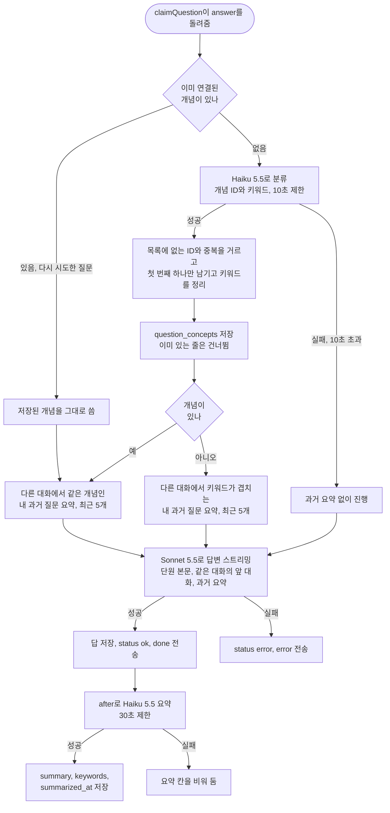
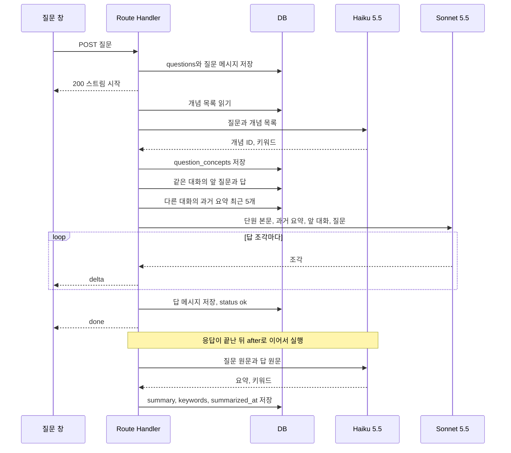
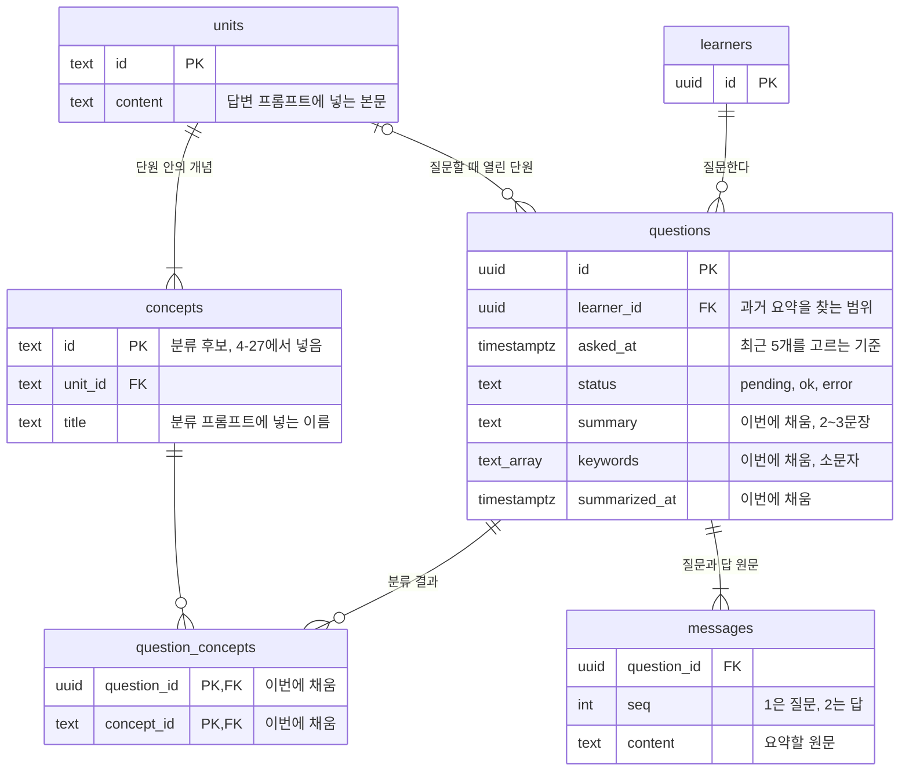

# 질문 개념 분류와 요약 설계

## 한 문장 요약

답하기 전에 Haiku 5.5가 새 질문을 개념으로 분류하면, 서버는 같은 학습자가 다른 대화에서 같은 개념으로 물었던 최근 질문 5개의 요약을 답변 프롬프트에 넣고, 답이 끝난 뒤 Haiku 5.5가 질문과 답을 2~3문장으로 요약해 저장한다.

## 근거

- 원천 자료: Linear [4-61 질문을 개념으로 분류하고 요약 남기기](https://linear.app/silo0/issue/4-61) "할 일", "완료 기준", Linear 문서 [05-1 기록 구조 테이블 설계](https://linear.app/silo0/document/05-1-기록-구조-테이블-설계-0c3075a457c4) "질문 하나가 저장되는 흐름" 2, 3, 5번과 "아직 정하지 않은 것" 3, 5번
- 확인 날짜: 2026-11-04, 2026-11-05에 대화 세션과 개념 데이터 반영
- 자료 성격: Linear 이슈와 문서, `4-61` 브랜치 코드 `lib/questions.ts`, `lib/llm/answer.ts`, `lib/db/schema.ts`, `app/api/questions/route.integration.test.ts`
- 결정한 사람: 개발자. 결정의 근거와 대안은 [ADR 0008](adr/0008-question-concept-summary.md)에 있다
- 관련 문서: [ADR 0007](adr/0007-ai-model.md), [질문 서버와 질문 창](../output/2026-11-03-question-server.md), [노션 Test-case DB](https://app.notion.com/p/40ce7e8fdd1280268097ef263f610f7a) TC-61~70, TC-86, TC-180. TC-61은 폐기했다

## 확인된 내용

### 하는 일

| 순서 | 하는 일 | 쓰는 곳 |
| --- | --- | --- |
| 답하기 전 | Haiku 5.5가 새 질문을 개념으로 분류하고 키워드를 뽑는다. 개념은 `question_concepts`에 저장한다 | 내 이해 기록의 "많이 물어본 개념", 과거 질문 찾기 |
| 답하기 전 | 같은 학습자가 다른 대화에서 물은 과거 질문 가운데 같은 개념인 질문의 요약을 최근 5개까지 찾는다. 개념이 없으면 키워드로 찾는다 | 답변 프롬프트 |
| 답한 뒤 | Haiku 5.5가 질문과 답을 2~3문장으로 요약하고 키워드를 뽑아 `summary`, `keywords`, `summarized_at`에 저장한다 | 다음 질문의 과거 요약 |

답변은 지금처럼 Sonnet 5.5가 한다. 분류와 요약은 질문 하나에 한 번씩 따로 부른다. 05-1 "아직 정하지 않은 것" 5번에서 분류를 답변 전에 따로 하기로 한 제안을 따른다.

### 전체 흐름



### 요청 하나의 순서



분류는 `claimQuestion`이 `answer`를 돌려준 요청에서만 한다. 이미 답한 질문을 다시 받거나 처리 중인 질문을 받은 요청은 분류하지 않는다. 분류하는 동안에도 Route Handler는 15초마다 연결 유지 신호를 보내므로, 질문 창은 지금과 같이 기다린다.

### 테이블 구조

새 테이블과 컬럼은 없다. 4-59에서 만든 `drizzle/0002_study_records.sql`의 컬럼을 채우기 시작한다.



`concepts`에는 학습 화면 본문의 소제목 하나를 개념 하나로 본 24개가 들어 있다. 2026-11-05에 송호윤이 Linear [4-79](https://linear.app/silo0/issue/4-79) 코멘트로 정했고, `drizzle/0004_concepts.sql`로 넣는다. 코드는 개념 수를 고정하지 않고 `concepts` 테이블을 읽어 분류 프롬프트에 넣는다. 2026-11-09부터 개념마다 `lib/llm/concept-notes.ts`의 한 줄 정리를 붙이고, 한 줄 정리가 없는 개념은 이름만 넣는다. 근거는 [ADR 0012](adr/0012-single-concept-classification.md)다.

### 분류

| 항목 | 정한 것 |
| --- | --- |
| 모델 | Claude Haiku 5.5. 모델 ID는 `env.ANTHROPIC_UTILITY_MODEL`로 읽는다 |
| 후보 | 단원과 상관없이 `concepts` 전체. 학습자가 열린 단원과 다른 내용을 물어도 맞는 개념에 연결한다 |
| 입력 | 질문 원문, 개념 ID와 이름과 한 줄 정리 목록 |
| 출력 | 개념 ID 목록과 키워드 목록. 프롬프트는 개념을 최대 하나만 고르게 하지만 가끔 둘을 고른다. 해당하는 개념이 없으면 빈 목록과 키워드만 돌려준다 |
| 출력 정리 | 개념 목록에 없는 ID와 중복을 버린다. TC-66 |
| 저장 | 남은 ID 가운데 첫 번째 하나만 `question_concepts`에 넣는다. 2026-11-09 [ADR 0012](adr/0012-single-concept-classification.md). TC-180 |
| 키워드 정리 | 소문자로 바꾸고 앞뒤 공백을 지운 뒤, 빈 값과 중복을 버린다. 한글은 그대로 둔다. 분류와 요약이 같은 함수를 쓴다. TC-70 |
| 제한 시간 | 10초. 넘으면 실패로 보고 과거 요약 없이 답한다. TC-64 |
| 다시 시도 | 이미 연결된 개념이 있으면 분류하지 않고 그 개념으로 과거 요약을 찾는다. 저장은 이미 있는 줄을 건너뛴다. TC-67 |

분류에서 뽑은 키워드는 과거 질문을 찾는 데만 쓰고 저장하지 않는다. `keywords` 컬럼에는 답을 받은 뒤 요약에서 뽑은 키워드를 저장한다.

### 과거 요약 찾기

| 조건 | 내용 |
| --- | --- |
| 학습자 | 지금 질문한 학습자의 질문만 찾는다. 다른 학습자의 요약은 넣지 않는다. TC-63, TC-69 |
| 대상 | `summary`가 있는 질문만 찾는다 |
| 대화 | 지금 대화의 질문은 뺀다. 같은 대화의 앞 질문과 답은 원문으로 이미 넘기므로, 요약으로 다시 넣으면 같은 내용이 두 번 들어간다. 지금 질문도 이 조건으로 빠진다. TC-86 |
| 개념이 있을 때 | 지금 질문의 개념 가운데 하나라도 같은 개념에 연결된 질문을 찾는다. TC-63 |
| 개념이 없을 때 | 지금 질문의 키워드 가운데 하나라도 `keywords`와 겹치는 질문을 찾는다. 05-1 "아직 정하지 않은 것" 3번에서 목록에 없는 개념은 `keywords`에만 남기기로 한 제안을 따른다. TC-69 |
| 개수 | `asked_at`이 늦은 순서로 5개까지. 개념으로 찾을 때와 키워드로 찾을 때 모두 같다. TC-68 |

### 답변 프롬프트에 넣는 방법

과거 요약은 시스템 프롬프트에서 단원 본문 다음, 캐시 지점 뒤에 둔다. 단원 본문은 지금처럼 캐시되고, 질문마다 달라지는 과거 요약만 캐시 밖에 있다. 과거 요약이 없으면 이 블록을 넣지 않는다.

```text
[시스템 1] 학습자가 아래 단원을 읽다가 질문했다. 단원 내용을 바탕으로 한국어로 답한다.
[시스템 2] <unit>단원 본문</unit>                    ← 캐시 지점
[시스템 3] <past_questions>이 학습자가 다른 대화에서 물었던 질문의 요약 최대 5개</past_questions>
[앞 대화] 같은 대화에서 답을 받은 질문과 답 원문
[사용자]   질문 원문
```

요약 하나를 300자 이내로 만들므로, 5개를 넣어도 1,500자 정도다.

### 요약

| 항목 | 정한 것 |
| --- | --- |
| 모델 | Claude Haiku 5.5, `env.ANTHROPIC_UTILITY_MODEL` |
| 시점 | 답을 저장하고 `done`을 보낸 뒤 Next.js `after`로 실행한다. 학습자는 요약을 기다리지 않는다. TC-62 |
| 입력 | `messages`의 질문 원문과 답 원문 |
| 출력 | 무엇을 헷갈려 물었고 답의 핵심이 무엇이었는지를 2~3문장, 300자 이내로 쓴 요약과 키워드 목록 |
| 실패 | Sentry에 남기고 요약 칸을 비워 둔다. 질문은 `ok` 그대로다. TC-65 |
| 제한 시간 | 30초. `제안` |

### 실패와 다시 시도

| 상황 | 처리 | 테스트 |
| --- | --- | --- |
| 분류 AI 오류, 10초 초과 | 개념 없이, 과거 요약 없이 답한다 | TC-64 |
| 분류 결과에 없는 개념 ID | 버리고 나머지만 저장한다 | TC-66 |
| 답변 실패 뒤 같은 질문 ID로 다시 시도 | 저장된 개념을 다시 쓰고, 개념 연결은 겹치지 않는다 | TC-67 |
| 요약 AI 오류 | 요약 칸을 비워 두고 `ok`를 유지한다 | TC-65 |
| 요약이 비어 있는 과거 질문 | 과거 요약 찾기에서 빠진다 | 없음 |

분류와 요약 오류는 Sentry에 남기되, 질문 원문과 요약은 넣지 않는다. ([ADR 0005](adr/0005-sentry-error-monitoring.md))

### 시간 제한

| 구간 | 제한 | 이유 |
| --- | --- | --- |
| 분류 | 10초 | 모든 질문의 첫 글자 앞에 붙는 시간이라 짧게 둔다 |
| 답변 | 첫 글자 60초, 전체 240초 | 지금 값 그대로다. 두 제한은 `streamAnswer` 안에서 재므로 분류 시간은 포함하지 않는다 |
| 요약 | 30초, `제안` | 가장 늦을 때 10초, 240초, 30초를 더해 280초다. Vercel Hobby 함수 제한 300초 안에 끝난다 |

### 테스트 케이스

| 케이스 | 확인하는 것 |
| --- | --- |
| TC-61 | 폐기. 2026-11-09에 TC-180으로 대신했다 |
| TC-180 | AI가 개념을 여러 개 골라도 목록에 있는 첫 번째 개념 하나만 `question_concepts`에 저장된다 |
| TC-62 | 답이 끝난 뒤 요약, 키워드, 요약 시각이 채워진다 |
| TC-63 | 같은 개념인 내 과거 요약만 답변 요청에 들어간다 |
| TC-64 | 분류가 실패하거나 10초를 넘어도 답을 받는다 |
| TC-65 | 요약이 실패해도 `ok`이고 요약 칸은 비어 있다 |
| TC-66 | 분류 결과에서 목록에 없는 ID와 중복을 버린다 |
| TC-67 | 다시 시도해도 개념 연결이 겹치지 않는다 |
| TC-68 | 과거 요약은 최근 5개까지만 넘긴다 |
| TC-69 | 개념이 없으면 키워드가 겹치는 내 과거 요약을 넘긴다 |
| TC-70 | 키워드를 소문자로 맞추고 공백과 중복을 없애며 한글은 남긴다 |
| TC-86 | 지금 대화의 질문은 과거 요약으로 넣지 않고, 다른 대화의 요약은 넣는다 |

기존 통합 테스트의 Anthropic 목은 `messages.stream`만 바꾸고, TC-35, TC-46, TC-50은 `stream` 호출 횟수를 1번으로 확인한다. 그래서 분류와 요약은 스트리밍하지 않는 호출로 부르고, 이 호출이 실패해도 답이 끝나야 기존 테스트가 그대로 통과한다.

## 확인 필요

- 요약 제한 시간 30초는 `제안`이다. 개발자가 정하지 않았다.
- 실제 개념 24개로 분류가 맞는지는 운영 데이터로 확인한다. 개념 이름만으로 분류가 부정확하면 `concepts`에 설명 칸을 더할지 다시 본다.
- 키워드는 글자가 같아야 겹친다. `인덱스`와 `index`, `인덱스를`과 `인덱스`는 다른 키워드다. 프롬프트로 "조사 없는 명사, SQL 용어는 영어"를 요청하지만 출력은 보장하지 않는다.
- Haiku 5.5에서 분류 결과를 JSON으로 받는 방법은 구현할 때 SDK 문서로 확인한다.
- Haiku 5.5 분류가 첫 글자를 얼마나 늦추는지는 운영에서 처음 잰다.

## 다시 물어볼 질문

- 내 이해 기록 화면의 "많이 물어본 개념"은 `question_concepts`를 어떻게 집계해 보여 줄까?
- 프롬프트를 바꿔 요약을 다시 만들 때, 이미 저장한 요약을 덮어쓰는 작업은 언제 어떻게 돌릴까?
